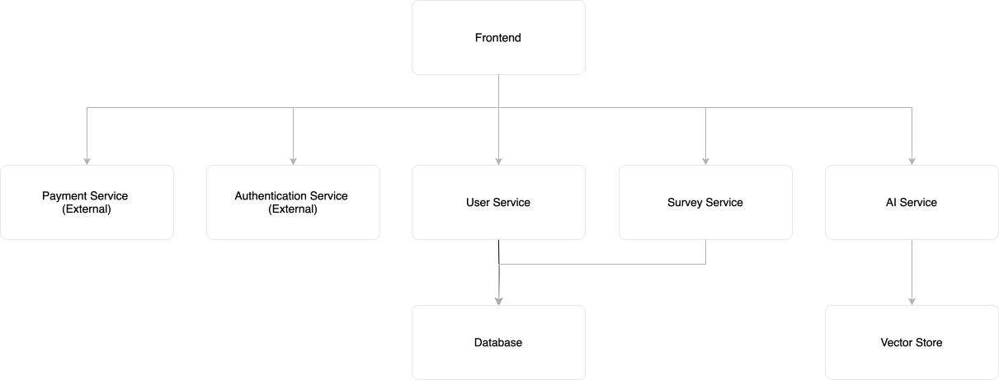
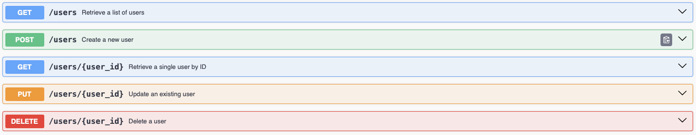
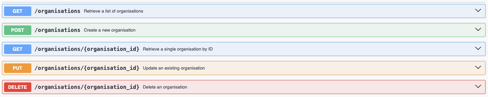

# Voicely

Voicely is SaaS platform for Customer Service, Marketing and Sales departments to streamline and simlify workflows. Its survey capabilities let teams allow to create meaningful and insightful surveys that deliver responses that are actionable. Offering an integration to common CRM tools such as Salesforce, Hubspot, Mailchimp, ..etc. customer data is acccisible and forms the basis to send out surveys. Utilizing AI, a knowledge base is set up to help with customer specific information. 

## Architecture
The current architecture follows a monolithic codebase. A monolithic architecture is a software design model where all components of an application are unified into a single, self-contained unit. In this approach, the entire application is built, deployed, and managed as a single entity, often referred to as a monolith. This allows for early stage simlicity and fast iteration.




### System design
TBD


## Folder Structure
The project has the following structure:
```
.githooks/
    commit-msg
.gitignore
.vscode/
    settings.json
docs/
    ...
deploy/
    .gitkeep
docker-compose.yml
Makefile
README.md
widget/
    backend/
        Dockerfile
        server.js
        package.json
    chat-widget/
        src/
        Dockerfile
        package.json
        vite.config.js
    test-env/
    docker-compose.dev.yml
    docker-compose.prod.yml
    .env.example
voicely/
    integrations/
        hubspot/
        salesforce/
    website/
        app/
            db/
                __schema/
                    schema.sql
                __test_data/
                    data.sql
                my.cnf
            services/
                knowledge_base_service/
                surveys_service/
                users_service/
                    .env
                    coverage/
                        ...
                    Dockerfile
                    main.js
                    package.json
                    scripts/
                    tests/
                        __mocks__
                    main.js
                    users.js
                    utils/
                        db/
        frontend/
            public/
            src/
.env.local
.eslintrc.js
```

## Getting Started
This section describes steps to get started with the development lifecycle by setting up a local environment following best practises such as the utlization of docker and test coverage.

### Installation
To get started with the project, follow these steps:

1. Clone the repository:

```bash
git clone https://github.com/yourusername/voicely.git
cd voicely
```

2. Install dependencies for services:
```bash
cd voicely/website/app/services/xxxxxx_service
yarn install
```

3. Set up the environment variables:
```bash
cp .env.local .env
```

4. Set up widget environment variables:
```bash
cd widget
cp .env.example .env.dev
# Edit .env.dev with your configuration
```

### Usage with Makefile

The project includes a Makefile for streamlined development workflows. Use `make help` to see all available commands.

**Start everything (widget + services):**
```bash
make dev
```

**Widget-specific commands:**
```bash
make widget-dev      # Start widget in development mode
make widget-build    # Build widget for production
make widget-test     # Run widget tests
make widget-clean    # Clean widget build artifacts
```

**Services-specific commands:**
```bash
make services-dev    # Start all main services
make services-build  # Build all main services
make services-test   # Run tests for all services
make services-clean  # Clean service build artifacts
```

**Combined commands:**
```bash
make build           # Build everything
make test            # Run all tests
make clean           # Clean all build artifacts
make stop            # Stop all running containers
make logs            # View logs from all services
```

**Database commands:**
```bash
make db-start        # Start database only
make db-stop         # Stop database
```

### Manual Usage (Alternative)
To start services manually using Docker Compose:

**Main services:**
```bash
docker-compose up --build
```

**Widget (development):**
```bash
cd widget
docker-compose -f docker-compose.dev.yml up --build
```

**Widget (production):**
```bash
cd widget
docker-compose -f docker-compose.prod.yml up --build
```

To run a service locally:
```bash
cd voicely/website/app/services/xxxxxx_service
yarn run dev
```

To run tests:
```bash
yarn test
```


## Users Service
The users service is a REST API that manages the handling and common operations for user data.

### Endpoints
The user service provides the following endpoints acessible through `api-docs/`:
 

## Organisations Service
The organisations service is a REST API that manages the handling and common operations for organisations data.

### Endpoints
The organisation service provides the following endpoints acessible through `api-docs/`:


## Widget
The widget is a chat widget component that can be embedded in customer websites. It consists of:

- **Backend**: Socket.io server for real-time messaging (port 4000)
- **Chat Widget**: React-based frontend component built with Vite
- **Test Environment**: Nginx server for testing the widget (port 8080)

### Widget Development
The widget has separate development and production environments configured via docker-compose files:

- `widget/docker-compose.dev.yml` - Development environment with hot reload
- `widget/docker-compose.prod.yml` - Production environment

Environment variables are configured in:
- `widget/.env.dev` - Development configuration
- `widget/.env.prod` - Production configuration

See `widget/.env.example` for available configuration options.

### Widget Usage
The widget can be started using the Makefile:
```bash
make widget-dev    # Development mode
make widget-build  # Production build
```

Or manually:
```bash
cd widget
docker-compose -f docker-compose.dev.yml up --build
```

## Contributing
Contributions are welcome! Please open an issue or submit a pull request.

## License
This project is licensed under the MIT License.