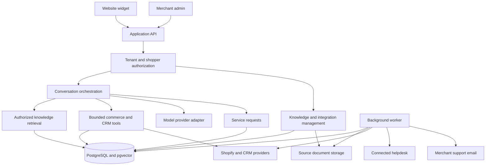

# System architecture

**Status: approved architecture baseline, with a local foundation implemented.** The [Linear project](https://linear.app/personal-rp501/project/voicely-ai-sales-and-support-agent-66ae94a7c2cb) is the source of truth. [PER-13](https://linear.app/personal-rp501/issue/PER-13) owns remaining contracts and validation. Stack approval does not establish production readiness.

The [product scope](product.md) contains approved behavior. The [root README](../README.md#current-implementation) distinguishes the active foundation from planned features. The older [Architecture.svg](Architecture.svg) is a historical survey-era diagram.

## Shape and tradeoffs

Prefer a **modular monolith with a separately deployed background worker** sharing domain code. The API handles interactive work; the worker handles ingestion, synchronization, aggregate computation, and handoff delivery. Domain interfaces stay explicit while background capacity can scale independently.

This avoids introducing distributed-service coordination before independent services are justified. A combined relational/retrieval store reduces initial data-system complexity. Revisit those choices based on measured workload, retrieval quality, and operational requirements.

Request creation and outbox scheduling happen atomically in the database. The worker consumes durable work; the diagram does not imply that model output can bypass authorization or select arbitrary destinations.

## Approved technology choices

| Area                         | Approved baseline                                                                                   | Still to decide or validate                                                    |
| ---------------------------- | --------------------------------------------------------------------------------------------------- | ------------------------------------------------------------------------------ |
| Language and admin           | Strict TypeScript; standalone React admin; Bun workspace/tooling                                    | Admin screens and Cognito OIDC integration                                     |
| API                          | Supported Node.js LTS and Fastify                                                                   | First-slice request/response schemas, versioning and errors                    |
| Persistence and retrieval    | RDS PostgreSQL, pgvector, full-text/exact SKU matching; RLS behind authorization                    | Filtered recall/latency, index strategy, existing data inventory               |
| Documents                    | Private S3                                                                                          | Extraction quality and retention configuration                                 |
| Jobs and delivery            | pg-boss with atomic business-record/job persistence                                                 | External retry/reconciliation contracts; independent business-record retention |
| Widget                       | Async loader, lazy React iframe, versioned assets and rollback; Shopify theme app embed             | CSP, account/guest bootstrap and host-page behavior                            |
| Chat transport               | HTTP submissions and authenticated SSE; fetch client for bearer headers                             | Replay/resume, reconnect, cancellation and actual ALB behavior                 |
| Models                       | Provider SDK behind a small application-owned adapter                                               | Model/embedding/extraction evaluation on merchant cases                        |
| Deployment                   | AWS us-east-1; ECS Fargate/ALB, RDS, S3/CloudFront, Secrets Manager; CDK TypeScript and GitHub OIDC | Actual staging deployment, IAM/networking, cost estimate, restore/rollout      |
| Staff authentication / email | Cognito OIDC / SES                                                                                  | Tenant memberships, sender domain, SES production access, delivery events      |
| Verification / operations    | Vitest, real PostgreSQL, Playwright; OpenTelemetry and CloudWatch                                   | Real connector contracts, quality measurements, production telemetry           |

The workspace implements configuration, public demo catalogs, database migrations/tenant-context RLS, transactional queue integration and a catalog-audit worker. The historical JavaScript/Express/Socket.io/MySQL application has been removed and remains available in Git history. Real shopper authentication, AI, admin and commerce/delivery integrations are not implemented by this foundation.

Demo infrastructure should be right-sized and initially Single-AZ for the database. Review availability before merchant production. Bound database pools and worker concurrency; include load balancers, networking, logs and backups in cost estimates. Measure quality and latency per dollar rather than assuming a larger model or instance is better.

## Module boundaries

| Module                       | Responsibilities                                                                                              |
| ---------------------------- | ------------------------------------------------------------------------------------------------------------- |
| Tenancy and identity         | Merchant accounts, staff roles, sites, visitor sessions, verified shopper links, and authorization            |
| Knowledge                    | Upload, extraction, product associations, source versions, publication, retrieval, and citations              |
| Commerce                     | Products/variants, orders, fulfillment, operational provenance, and freshness                                 |
| CRM                          | Salesforce/HubSpot mappings and permitted customer context                                                    |
| Conversations                | Durable messages, streaming, tool calls, feedback, and session ownership                                      |
| Service requests and handoff | Structured requests, configured destinations, transactional delivery jobs, attempts, and delivery diagnostics |
| Recommendations              | Tenant-specific aggregate sales signals with product-fit constraints                                          |
| Operations and evaluation    | Usage/cost, traces, quality evaluation, connector health, and recovery                                        |

Each module owns access to its data and exposes an explicit interface. Use an explicit verify/retrieve/bounded-tools/validate/answer-or-request workflow. Application code controls identity, tool authorization and submission state. Specify tool budgets, timeout/cancellation and evidence. These domain modules will grow out of the minimal shared foundation as their behavior is implemented.

## Identity and tenant isolation

- A public widget site ID selects configuration. It is not a secret or proof of shopper identity.
- Issue server-owned sessions and conversation IDs. Authorize history, streaming, citations, tool results, and request access against tenant and shopper scope.
- Anonymous visitors receive approved public product/policy information. Private orders and CRM records require verified identity and record-level access.
- Validate a Shopify-supported identity flow in a development store. Custom sites may use short-lived backend-signed assertions with signature, audience, tenant, expiry, and replay checks.
- Guest-purchaser verification must be tied to a trusted order contact channel. A chat-entered email/order number or browser-generated visitor ID alone is insufficient.
- Keep contact confirmation for email follow-up distinct from identity proof for private data.
- Enforce tenancy across database rows, object storage, retrieval, caches, background jobs, and connector credentials. The model cannot widen this scope.
- Add PostgreSQL RLS behind application authorization. Test API/worker roles without ownership/superuser/BYPASSRLS, including pooled connection reuse after commit and rollback. Foundation tests cover catalog/audit rows, not yet private shopper records.
- Define logout/account switching and expiry behavior without relying on third-party cookies for widget continuity.

## Knowledge and operational facts

Store manuals, product descriptions, and policies as versioned sources with searchable chunks, product/variant links, access metadata, and page/section citations. Define publication, replacement, unpublishing, and deletion propagation across source storage and retrieval.

Access private orders and CRM history through structured, authorized tools. Keep prices, availability, and fulfillment facts structured with provenance and freshness rules. Avoid placing all raw CRM/order records in a shared vector index.

Shopify is the initial commerce source; HubSpot is the first CRM, followed by Salesforce. Define source precedence, customer/product mappings, and duplicate-purchase handling in [PER-20](https://linear.app/personal-rp501/issue/PER-20). A CRM connection does not automatically authorize helpdesk ticket creation.

Use background sync for catalogs/history and on-demand refresh for facts that exceed workflow freshness limits. Missing, stale, or conflicting data should produce clarification or a staff request rather than an invented answer.

Compute aggregate sales patterns in controlled tenant-scoped jobs. Apply suitability, compatibility, and permitted availability constraints before popularity. Preserve cohort thresholds, provenance, and sparse-data fallbacks.

## Conversation and request flow

For an exchange enquiry:

1. Establish tenant/session identity and verify access to the shopper's order.
2. Retrieve the purchased item, current permitted variant facts, and applicable published policy.
3. Ask for missing information such as reason and desired size.
4. Evaluate explicit merchant rules; flag unknown eligibility, conflicting policies, or unavailable stock.
5. Prepare a request with relevant authorized context and confirm the contact email.
6. Let the shopper review details, then persist the request and delivery work atomically.
7. Deliver to the connected helpdesk or, if none is connected, merchant support email.
8. Show an accurate status and request reference. Staff continue by email.

The [PER-32 first-slice specification](https://linear.app/personal-rp501/issue/PER-32) defines the planned tools: `knowledge.search`, `commerce.lookupVariants`, `commerce.lookupOrder` and `requests.prepareDraft`. Tenant/customer scope comes from the server, not model-provided identifiers. Only the explicit shopper submit endpoint can schedule external delivery.

## Durable delivery and truthful state

Persist a `ServiceRequest` independently of the transcript, including tenant/conversation reference, contact and verification provenance, authorized order/item context, desired outcome, policy evidence, missing information, and a stable request reference.

Enqueue a pg-boss delivery job in the same PostgreSQL transaction. Transactional enqueue can fulfill the outbox role without a second generic dispatcher. Retain business/attempt records independently of queue retention. Workers use destination idempotency where supported, bounded retries, external references and reconciliation. Queue guarantees do not establish exactly-once external effects. Never hold a database transaction across a provider call. After possible remote success, preserve uncertainty until reconciled rather than blindly retrying or changing channels.

- **Helpdesk connected:** create a ticket in the configured provider. Staff follow up by email through it.
- **No helpdesk connected:** send to the configured merchant support address from an authenticated Voicely-controlled address. Set `Reply-To` to the shopper's validated, confirmed contact address.
- **Configured helpdesk outage:** retry/reconcile that route and expose failure. PER-32 specifies no automatic cross-channel rerouting for the first slice. Any future force-resend or rerouting behavior needs a separate decision.

Keep queue state, provider acceptance, observable delivery, and customer resolution separate. Show pending before acknowledgement; do not equate email acceptance with reading or resolution. Expose bounces/failures and controlled retry diagnostics where supported. Unknown resolution remains unknown unless supported destination data or pilot follow-up supplies evidence.

The approved model has no internal support-agent inbox, staff assignment/live takeover, reply composer, or replies streamed from a helpdesk back into the widget. Admin conversation review and delivery diagnostics are still required. [PER-26](https://linear.app/personal-rp501/issue/PER-26) owns the delivery acceptance criteria.

## First-slice contract specification

**Status: specified in [PER-32](https://linear.app/personal-rp501/issue/PER-32), pending implementation review and external validation.** That issue is the authoritative detailed specification, including endpoint fields, screen states, ownership constraints, wire examples, failure transitions and the verification matrix. The current foundation still exposes only health and synthetic catalog endpoints.

### Identity and HTTP

- Staff roles are owner, editor and reviewer, backed by current application memberships and Cognito identity.
- New routes use `/v1/admin/tenants/{tenantId}` and `/v1/widget`; Shopify/SES ingress lives under `/v1/integrations`. Foreign resources return indistinguishable denials.
- HTTP contracts use Fastify-native JSON Schema, with generated OpenAPI/client types and a CI drift check when implemented.
- Anonymous bootstrap creates a fresh empty session. A public idempotency key must never replay bearer credentials. Access tokens last 5 minutes and opaque resume tokens have a 24-hour absolute lifetime; optional browser storage is not required for public functionality.
- Private access requires a scoped grant, capped at 15 minutes for the first slice. Guest proof is tied to the trusted order contact and grants only that order. Actual Shopify/account-switch coverage remains PER-27's validation gate.
- Upgrading proof increments the identity epoch and invalidates prior access tokens; the iframe renews through its existing secret resume token. Account switching/logout revokes the full session and starts a new conversation.
- Authenticated mutations use principal/resource-scoped idempotency keys and canonical payload hashes. Revisioned configuration/drafts use `If-Match`; submit includes the reviewed revision. Unique message/draft constraints outlive the 24-hour transport replay cache.

### Conversation and review

- Runs transition from `queued` to `running`, then `completed`, `failed`, `cancelled` or `interrupted`. One active run is allowed per conversation. Lease fencing rejects stale/late output.
- Initial configurable limits: six tool invocations, 60 seconds per run, 10 seconds per read tool, a 90-second run lease and 15-second heartbeat. These are implementation limits, not measured performance.
- Buffer and validate model answers before persisting/streaming presentation chunks. Generic progress may stream earlier. This deliberately prioritizes the output-validation boundary over earliest-token latency; measure the first-useful-response target.
- Fetch-based SSE replays ordered durable events. Reconnect never resubmits a message. An expired replay cursor restores an authorized snapshot; cancellation does not erase an accepted service request.
- Request drafts are editable/revisioned, require reviewed contact/reason/desired outcome, and disclose unknown policy/stock facts. Default expiry is 30 minutes after the last edit. Material changes require another review.
- Submit revalidates proof/evidence/configuration, then commits the immutable request, unique draft submission, idempotency result, event and pg-boss job atomically. External calls happen outside database transactions.

### Delivery and recovery

- Track independent `dispatchState` (`queued`, `sending`, `retry_wait`, `uncertain`, `accepted`, `failed`), `receiptState` (`unknown`, `delivered`, `bounced`, `rejected`, `complained`) and `resolutionState` (`unknown`, `confirmed` with evidence). SES resolution remains unknown in this slice.
- Persist attempt phase `prepared`, then `calling` before the external call. A crash/timeout after the call may have started enters `uncertain`; expired leases do not authorize another send.
- SES `SendEmail` has no idempotency-token field. Disable automatic SDK retries for ambiguous sends. Correlate configuration-set events using persisted request/attempt tags and message IDs; event absence is not evidence of non-delivery.
- Only definitive transient non-acceptance permits bounded retries: at most five calls, with 5-second, 30-second, 2-minute and 10-minute delays plus jitter, respecting longer provider backoff and a 24-hour deadline.
- Freeze the destination at submit. Uncertain requests cannot be resent through shopper or admin retry controls. Keep late delivery/bounce evidence without last-arrival-wins state corruption.

Sources: [PER-32](https://linear.app/personal-rp501/issue/PER-32), [SES SendEmail](https://docs.aws.amazon.com/ses/latest/APIReference-V2/API_SendEmail.html). Provider behavior and the complete customer journey still require real integration checks.

## Planned data model

PER-32 specifies ownership, fields and constraints for these planned entities; implementation uses new append-only migrations:

- `Tenant`, `StaffMembership`, `Site`, `ShopperSession`, `VerifiedIdentityLink`.
- `Conversation`, `Message`, `Run`, `ToolInvocation`, `ConversationEvent`.
- `KnowledgeSource`, source versions/chunks, product/variant associations.
- `ConnectorConnection`, sync checkpoints, authorized product/order/fulfillment records.
- `RequestDraft`, `ServiceRequest`, `HandoffDestination`, transactional delivery jobs, `DeliveryAttempt`, `ProviderEvent`, `IdempotencyRecord`. A separate `OutboxEvent` table requires a demonstrated additional purpose.
- Usage, audit, and evaluation records.

Use PER-32's endpoint contracts for widget bootstrap, messages/streaming/resume, shopper verification, request preview/submit/status, admin configuration/review, connector callbacks and verified webhooks. Physical migrations, runtime schemas and generated client contracts remain implementation work. The demo fixture JSON is not a production private-order or knowledge schema.

## First slice and verification

Implement the [first integrated product slice](product.md#first-integrated-slice). Exercise two merchants and two shoppers, private-history isolation, expired identity, policy conflicts, stale/unavailable Shopify, duplicate submission, reconnect, worker restart, email failure/bounce, and helpdesk timeout after remote success.

Cover both handoff routes before enabling them for pilot merchants. Measure sales/support answer quality separately from delivery and resolution. [PER-22](https://linear.app/personal-rp501/issue/PER-22) owns operational readiness, load, backup/restore, migration/rollback, quotas, alerts, and failure recovery.

## Open decisions

Remaining gates: actual shopper/guest proof and account-switch coverage; helpdesk capabilities and exact connector fields; model/embedding/extraction evaluation; retrieval indexes; real-merchant retention/deletion; SES event/reconciliation validation; measured AWS sizing, availability and streaming. PER-32 specifies first-slice API/state semantics and disables automatic rerouting; these are no longer blanket open design questions. SQL-first Drizzle remains conditional on compatibility evidence; the foundation uses node-postgres directly for explicit transactions.
