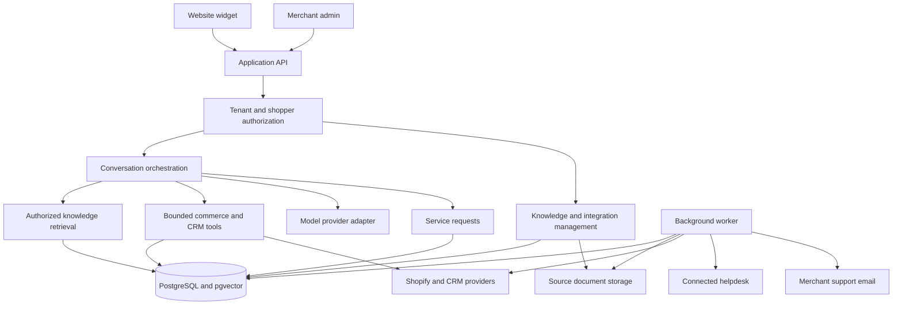

# System architecture

**Status: proposed architecture baseline, not the current implementation.** The [Linear project](https://linear.app/personal-rp501/project/voicely-ai-sales-and-support-agent-66ae94a7c2cb) is the source of truth. Finalize concrete design decisions and the first slice's schema/API contracts in [PER-13](https://linear.app/personal-rp501/issue/PER-13).

The [product scope](product.md) contains approved behavior. The [root README](../README.md#current-implementation) describes the repository baseline. The older [Architecture.svg](Architecture.svg) is a historical survey-era diagram, not this proposed design.

## Shape and tradeoffs

Prefer a **modular monolith with a separately deployed background worker** sharing domain code. The API handles interactive work; the worker handles ingestion, synchronization, aggregate computation, and handoff delivery. Domain interfaces stay explicit while background capacity can scale independently.

This avoids introducing distributed-service coordination before independent services are justified. A combined relational/retrieval store reduces initial data-system complexity. Revisit those choices based on measured workload, retrieval quality, and operational requirements.

Request creation and outbox scheduling happen atomically in the database. The worker consumes durable work; the diagram does not imply that model output can bypass authorization or select arbitrary destinations.

## Proposed technology choices

| Area | Proposed baseline | Still to decide or validate |
| --- | --- | --- |
| Language and admin | TypeScript and React | Package/module layout and deployment tooling |
| API | Node.js and Fastify | Request schemas, endpoints, versioning, and error semantics |
| Persistence and retrieval | PostgreSQL, pgvector, and full-text search | Retrieval benchmarks and existing MySQL migration needs |
| Documents | S3-compatible object storage | Provider, region, and retention configuration |
| Jobs and delivery | PostgreSQL-backed durable queue and transactional outbox | Queue library, retries, and reconciliation |
| Widget | Async loader, iframe isolation, versioned assets and rollback | Shopify installation, CSP, and host-page behavior |
| Chat transport | HTTP message submission and server-sent events | Scoped authentication, replay/resume, reconnect, and cancellation |
| Models | One initial provider behind an adapter | Quality, latency, cost, and data-handling evaluation |

The repository currently uses JavaScript, Express/Socket.io, and a survey-oriented MySQL schema. The proposal does not imply these replacements or migrations have happened.

## Module boundaries

| Module | Responsibilities |
| --- | --- |
| Tenancy and identity | Merchant accounts, staff roles, sites, visitor sessions, verified shopper links, and authorization |
| Knowledge | Upload, extraction, product associations, source versions, publication, retrieval, and citations |
| Commerce | Products/variants, orders, fulfillment, operational provenance, and freshness |
| CRM | Salesforce/HubSpot mappings and permitted customer context |
| Conversations | Durable messages, streaming, tool calls, feedback, and session ownership |
| Service requests and handoff | Structured requests, configured destinations, outbox events, attempts, and delivery diagnostics |
| Recommendations | Tenant-specific aggregate sales signals with product-fit constraints |
| Operations and evaluation | Usage/cost, traces, quality evaluation, connector health, and recovery |

Each module owns access to its data and exposes an explicit interface. Application code controls identity, tool authorization, and workflows; the model interprets intent and prepares answers or tool requests.

## Identity and tenant isolation

- A public widget site ID selects configuration. It is not a secret or proof of shopper identity.
- Issue server-owned sessions and conversation IDs. Authorize history, streaming, citations, tool results, and request access against tenant and shopper scope.
- Anonymous visitors receive approved public product/policy information. Private orders and CRM records require verified identity and record-level access.
- Validate a Shopify-supported identity flow in a development store. Custom sites may use short-lived backend-signed assertions with signature, audience, tenant, expiry, and replay checks.
- Guest-purchaser verification must be tied to a trusted order contact channel. A chat-entered email/order number or browser-generated visitor ID alone is insufficient.
- Keep contact confirmation for email follow-up distinct from identity proof for private data.
- Enforce tenancy across database rows, object storage, retrieval, caches, background jobs, and connector credentials. The model cannot widen this scope.
- Define logout/account switching and expiry behavior without relying on third-party cookies for widget continuity.

## Knowledge and operational facts

Store manuals, product descriptions, and policies as versioned sources with searchable chunks, product/variant links, access metadata, and page/section citations. Define publication, replacement, unpublishing, and deletion propagation across source storage and retrieval.

Access private orders and CRM history through structured, authorized tools. Keep prices, availability, and fulfillment facts structured with provenance and freshness rules. Avoid placing all raw CRM/order records in a shared vector index.

Shopify is the proposed initial operational source for the pilot; Salesforce and HubSpot enrich context. Define source precedence, customer/product mappings, and duplicate-purchase handling in [PER-20](https://linear.app/personal-rp501/issue/PER-20). A CRM connection does not automatically authorize helpdesk ticket creation.

Use background sync for catalogs/history and on-demand refresh for facts that exceed workflow freshness limits. Missing, stale, or conflicting data should produce clarification or a staff request rather than an invented answer.

Compute aggregate sales patterns in controlled tenant-scoped jobs. Apply suitability, compatibility, and permitted availability constraints before popularity. Preserve cohort thresholds, provenance, and sparse-data fallbacks.

## Conversation and request flow

For an exchange enquiry:

1. Establish tenant/session identity and verify access to the shopper's order.
2. Retrieve the purchased item, current permitted variant facts, and applicable published policy.
3. Ask for missing information such as reason and desired size.
4. Evaluate explicit merchant rules; flag unknown eligibility, conflicting policies, or unavailable stock.
5. Prepare a request with relevant authorized context and confirm the contact email.
6. Let the shopper review details, then persist the request and delivery work atomically.
7. Deliver to the connected helpdesk or, if none is connected, merchant support email.
8. Show an accurate status and request reference. Staff continue by email.

Illustrative tool boundaries include product knowledge search, product availability, the verified shopper's order/fulfillment lookup, and request preparation. Tool names and schemas remain specification work. Tenant/customer scope comes from the server, not model-provided identifiers.

## Durable delivery and truthful state

Persist a `ServiceRequest` independently of the transcript, including tenant/conversation reference, contact and verification provenance, authorized order/item context, desired outcome, policy evidence, missing information, and a stable request reference.

Create an outbox event in the same transaction. Workers deliver using stable idempotency keys, bounded retries/backoff, attempt records, external references, and reconciliation for unknown results. A timeout can occur after the remote provider succeeds; do not assume it is safe to issue a new ticket or switch channels.

- **Helpdesk connected:** create a ticket in the configured provider. Staff follow up by email through it.
- **No helpdesk connected:** send to the configured merchant support address from an authenticated Voicely-controlled address. Set `Reply-To` to the shopper's validated, confirmed contact address.
- **Configured helpdesk outage:** retry/reconcile that route and expose failure. Cross-channel rerouting is an open policy decision, not an implicit fallback.

Keep queue state, provider acceptance, observable delivery, and customer resolution separate. Show pending before acknowledgement; do not equate email acceptance with reading or resolution. Expose bounces/failures and controlled retry diagnostics where supported. Unknown resolution remains unknown unless supported destination data or pilot follow-up supplies evidence.

The approved model has no internal support-agent inbox, staff assignment/live takeover, reply composer, or replies streamed from a helpdesk back into the widget. Admin conversation review and delivery diagnostics are still required. [PER-26](https://linear.app/personal-rp501/issue/PER-26) owns the delivery acceptance criteria.

## Candidate data model and API contracts

Candidate entities, to specify in PER-13:

- `Tenant`, `StaffMembership`, `Site`, `ShopperSession`, `VerifiedIdentityLink`.
- `Conversation`, `Message`, `ToolInvocation`.
- `KnowledgeSource`, source versions/chunks, product/variant associations.
- `ConnectorConnection`, sync checkpoints, authorized product/order/fulfillment records.
- `ServiceRequest`, `HandoffDestination`, `OutboxEvent`, `DeliveryAttempt`.
- Usage, audit, and evaluation records.

Specify APIs for widget bootstrap, messages/streaming/resume, shopper verification, request preview/submit/status, admin content/configuration/review, connector installation/callbacks, and verified webhooks. Include authorization, validation, idempotency, errors, event replay, and lifecycle rules. This document does not finalize table schemas or endpoint names.

## First slice and verification

Implement the [first integrated product slice](product.md#first-integrated-slice). Exercise two merchants and two shoppers, private-history isolation, expired identity, policy conflicts, stale/unavailable Shopify, duplicate submission, reconnect, worker restart, email failure/bounce, and helpdesk timeout after remote success.

Cover both handoff routes before enabling them for pilot merchants. Measure sales/support answer quality separately from delivery and resolution. [PER-22](https://linear.app/personal-rp501/issue/PER-22) owns operational readiness, load, backup/restore, migration/rollback, quotas, alerts, and failure recovery.

## Open decisions

Concrete stack approval, provider/hosting region, authentication/guest proof, queue library, schema and API details, first CRM/helpdesk/email providers, pilot connector coverage, and helpdesk-outage rerouting remain open. Update the Linear project and relevant issue before treating a proposed choice as an implementation commitment.
