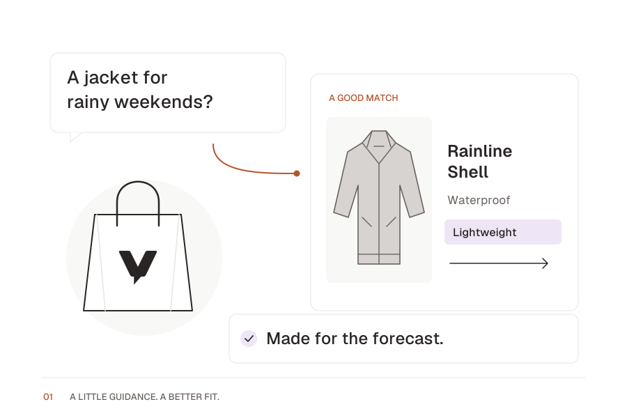

# Landing-page illustration and motion kit

Three original vector scenes extend Voicely's white, charcoal, burnt-orange and lavender identity. These are reusable marketing assets and working animation studies, not implemented product workflows. Product details and messages are synthetic examples; final public copy still needs review.

Open [the motion gallery](index.html) through the local HTTP server described in [the brand guide](../README.md). Each scene also has a standalone SVG and a 2× PNG.

| Scene                  | Suggested placement        | Story                                                              |
| ---------------------- | -------------------------- | ------------------------------------------------------------------ |
| `product-advice.svg`   | Hero or sales feature      | Buying question, rain shell recommendation, helpful answer         |
| `grounded-answers.svg` | Knowledge or trust feature | Merchant documents, grounded answer, visible source citation       |
| `human-handoff.svg`    | Support or handoff feature | Shopper review, prepared request summary, staff follow-up by email |

The handoff scene shows the intended sequence, not a dispatch receipt. It must not imply a sent email, a completed exchange, live staff presence or automatic operational action. In the product, review and submission are explicit and acceptance, inbox delivery and resolution remain different states.

## Art direction

White space, thin charcoal/stone outlines, grounded physical objects and a little orange to connect the story. Lavender identifies a helpful detail. Product, document and envelope silhouettes carry the meaning instead of abstract AI orbs. All display lettering is outlined from the checked-in Geist font, so SVG exports work without external fonts.

The illustrations are 900 × 600 with a 3:2 aspect ratio. PNGs are 1800 × 1200. Scale proportionally; do not crop the diagram or extract tiny labels as a substitute for live UI text. Pair each scene with a live HTML heading and description, as in the gallery. At small sizes the illustration is supporting imagery, not a text interface.

## Motion behavior

- Each scene plays once when its artwork enters the viewport, then settles into the complete static illustration. Reading the heading above an offscreen illustration does not start it. Sequences take approximately 2.5-3 seconds, with a hard 4-second limit per animation.
- Reveals move just 8px; connector strokes draw toward the next step. There is no endless loop, flashing, parallax or bounce.
- Replay and pause/resume are explicit controls. Offscreen scenes and hidden pages pause; manual pause remains in effect when the scene returns.
- `prefers-reduced-motion: reduce`, including changes while playing, shows the complete static scene. Replay and pause are disabled while that preference is active.
- The initial image stays usable if JavaScript is disabled, SVG enhancement fails or Web Animations is unavailable. HTTP(S) is required for animated enhancement; opening `index.html` directly from disk gives the static fallback.
- Animation never changes the accessible description or announces decorative frames through a live region. The illustrations have an accessible SVG label; their adjacent HTML explains the story.

## Integration

Copy the three SVGs and `motion.js` together. Use this structure for each scene, with one of the exact names in the table:

```html
<article data-motion-scene="product-advice">
  <h2>Find the right product</h2>
  <div data-scene-art>
    
  </div>
  <button type="button" data-motion-replay disabled>Replay</button>
  <button type="button" data-motion-pause disabled aria-pressed="false">Pause</button>
  <span data-motion-status>Static illustration</span>
</article>
<script type="module" src="./motion.js"></script>
```

The module automatically mounts existing scenes. Style `[data-scene-art] > img` and `[data-scene-art] > svg` with `display: block; width: 100%; height: auto`. Give buttons visible focus states and at least 44px touch targets. `gallery.css` is gallery styling, not a required application stylesheet.

For dynamically mounted content, import `mountScene(element)`. It returns `{ ready, replay, pause, resume, destroy }`; call `destroy()` during component cleanup. Mounting the same element twice reuses its controller. `ready` resolves when loading settles, including a usable static fallback on failure. Keep the trusted SVGs beside the module; do not use this loader for user-uploaded SVGs.

## Editing and exports

Edit `artwork.py`, then run from the repository root:

```sh
uv run --script docs/brand/build.py
bun docs/brand/landing/check.ts
```

The parent build uses the same font and palette as the logo kit, generates the SVG/PNG exports, and packages this directory in `voicely-brand-kit.zip`. Generated SVGs contain `data-motion` groups and paths; do not manually edit their outlines. Motion timings live in the illustration source; the controller caps them and owns visibility, cancellation and cleanup.

The browser check starts its own loopback server and exercises replay, pause/resume, completion cleanup, offscreen behavior, runtime reduced-motion changes, destroy/remount, responsive layout, no-JavaScript fallback and an SVG fetch failure. It is an explicit authoring-kit check, separate from the product's `bun run verify` gate.

These are local design assets. Shipping the actual landing page, product integration and measured accessibility/performance validation of that page are separate work.
